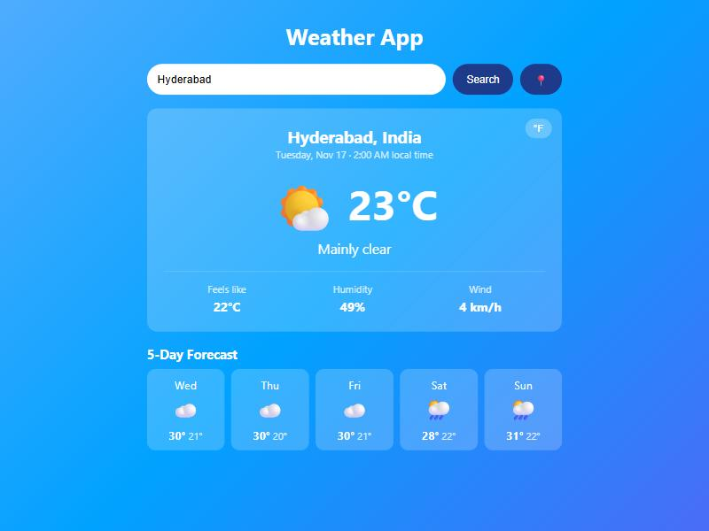

# 🌤️ Weather App

A simple weather app built with **HTML, CSS and vanilla JavaScript**.
Search any city in the world to see the current weather and a 5-day forecast.

This is **Day 2** of my daily project challenge, where I build one project every day, from simple to advanced.

🔗 **Live demo:** https://gopichandreddy007.github.io/weather-app/



## Features

- Search weather by city name
- Current temperature, "feels like", humidity and wind speed
- 5-day forecast with daily high and low
- Weather icons and descriptions
- Switch between °C and °F
- 📍 Get weather for your current location
- Shows the city's local date and time
- Background color changes with the weather (sunny, cloudy, rainy, snowy, stormy)
- Remembers your last city and unit (localStorage)
- Loading and error messages (for example, when a city isn't found)
- Responsive design that works on mobile

## Tech Stack

- HTML5
- CSS3 (Flexbox, Grid, media queries)
- JavaScript (ES6+, `fetch`, `async/await`)
- [Open-Meteo API](https://open-meteo.com/): free weather API, **no API key needed**

## How It Works

1. The city name is sent to the **Open-Meteo Geocoding API** to get its latitude and longitude.
2. The coordinates are sent to the **Open-Meteo Forecast API** to get the current weather and daily forecast.
3. The API returns a weather code (like `61` = light rain), which the app turns into a description and an icon.

## Project Structure

```
weather-app/
├── index.html     # page layout
├── style.css      # styles and mobile layout
├── app.js         # API calls and page updates
└── screenshots/
```

## Run Locally

No install needed. Clone the repo and open `index.html` in your browser:

```bash
git clone https://github.com/gopichandreddy007/weather-app.git
cd weather-app
```

Or run a small local server (needed for the location button in some browsers):

```bash
python -m http.server 5500
```

Then open http://localhost:5500

## What I Learned

- Calling two APIs one after another with `async/await`
- Handling errors with `try/catch` and checking `res.ok`
- Using the Geolocation API
- Saving user settings in `localStorage`
- Converting units on the frontend instead of calling the API again
- Building responsive layouts with media queries

## Future Ideas

- Hourly forecast chart
- City name suggestions while typing
- Save favorite cities
